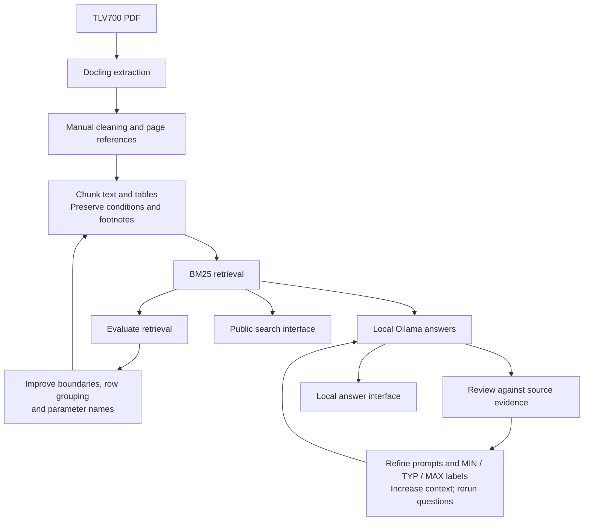

# TLV700 Datasheet Assistant

A local RAG application for the Texas Instruments TLV700 datasheet. It retrieves relevant text and tables using BM25 and generates answers using Ollama, with supporting evidence and PDF page references.

## Interfaces

| Interface | Function |
|---|---|
| Public Streamlit demo | Search and inspect datasheet passages |
| Local Ollama app | Generate answers with citations and supporting evidence |

The public demo is search-only. Answer generation runs locally using `qwen3:8b`.

## Tech Stack

Python · Docling · BM25 · Ollama · Qwen3 · Streamlit

## Workflow and Improvements



Unverified figures and appendix content are excluded from search.

## Project Structure

```text
app/
├── streamlit_app.py       # Public search-only interface
├── streamlit_local.py     # Local Ollama interface
└── requirements.txt
src/
├── chunk.py
├── search.py
├── evaluate.py
└── answer.py
data/
├── chunks/TLV700.jsonl
└── evaluation/
.streamlit/config.toml
```

## Setup

Run in PowerShell:

```powershell
git clone https://github.com/AditiS721/datasheet_assistant.git
cd datasheet_assistant

python -m venv .venv
.\.venv\Scripts\Activate.ps1
python -m pip install -r app/requirements.txt
```

### Search Interface

```powershell
python -m streamlit run app/streamlit_app.py
```

### Local Answer Interface

Install and open [Ollama](https://ollama.com), then run:

```powershell
ollama pull qwen3:8b
python -m streamlit run app/streamlit_local.py --server.address 127.0.0.1
```

Defaults: `qwen3:8b`, five retrieved passages, and an 8192-token context setting. The app uses the prepared chunk file; reprocessing PDFs requires Docling separately.

## Example Questions

- What is the maximum dropout voltage at 200 mA?
- Which voltage levels enable and disable the regulator?
- What ground pin current is specified at no load?
- Does a capacitor rated at 0.1 µF necessarily ensure stability?

## Evaluation

```powershell
python src/evaluate.py --chunks data/chunks/TLV700.jsonl --questions data/evaluation/questions.json --output data/evaluation/results.json
```

| Development set | Recorded Hit@5 |
|---|---|
| Original answerable questions | 9/9 on recheck |
| Additional questions | Improved from 9/10 to 10/10 after adding parameter names |

Hit@5 checks whether expected evidence appears in the top five results. One unanswerable question in the original set is excluded. These small sets were used during development; scores do not measure answer accuracy or generalisation.

Answer-generation improvements included explicit MIN / TYP / MAX labels, revised prompts, and increasing context from 4096 to 8192.

## Limitations

- Covers one datasheet; unverified figures and appendix content are excluded.
- The model can confuse table columns, omit conditions, or select the wrong row.
- Citation checks validate source IDs, not factual support.
- Context limits can exclude retrieved passages.
- The hosted demo cannot access Ollama running on a user's laptop.

Verify technical values and conditions against the original PDF before using them in a design.

## Source

Texas Instruments TLV700 datasheet, SLVSA00E, revision E, April 2015.

## Project Objective

Build an evidence-based assistant for electronics datasheets that retrieves technical specifications and generates answers with source-page citations.

## Learning Outcomes

Practical experience in PDF extraction, data cleaning, context-preserving chunking, BM25 retrieval, local LLM integration, evaluation, and deployment, with an emphasis on distinguishing retrieval performance from answer accuracy.
